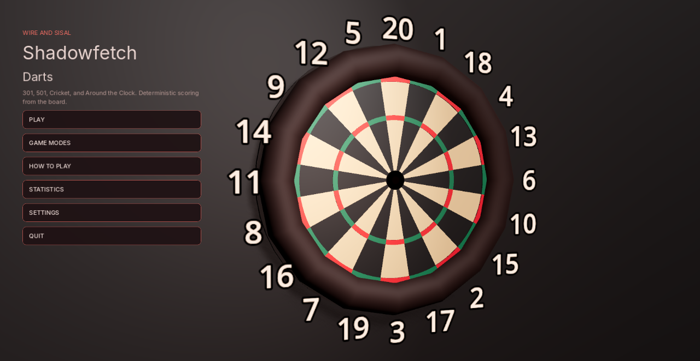
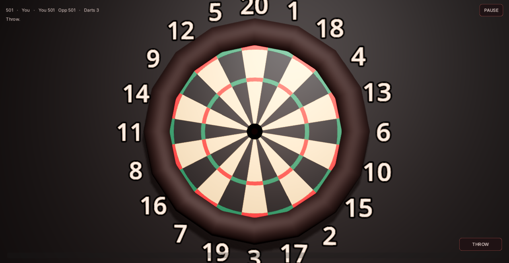

# Shadowfetch Darts

301, 501, Cricket, Around the Clock, and practice for Linux. Deterministic WDF board scoring. Sibling to Shadowfetch Roulette and Pool — same dark family, not a clone.





## Download

Get `shadowfetch-darts-1.0.0-linux-x86_64.tar.gz` from the [latest release](https://github.com/Shadowfetchapps/shadowfetch-darts/releases/latest) (x86_64 Linux), then:

```bash
sha256sum -c shadowfetch-darts-1.0.0-linux-x86_64.tar.gz.sha256
tar -xzf shadowfetch-darts-1.0.0-linux-x86_64.tar.gz
cd shadowfetch-darts-1.0.0-linux-x86_64
./tools/install_linux.sh
```

## Run

```bash
shadowfetch-darts
```

The installer copies the release binary to `~/.local/opt/shadowfetch-darts` and a launcher onto `PATH`. Development: open this project in Godot 4.7.

## Tests

```bash
./tools/run_tests.sh
```

Covers every ring and sector border, bull edges, 120,000 randomized coordinates, 301/501 busts and checkouts, Cricket marks, Around the Clock, and settings recovery from corrupt files.

## Export and install

```bash
./tools/export_linux.sh
./tools/install_linux.sh
```

If `rsvg-convert` is missing: `sudo apt install librsvg2-bin desktop-file-utils`

## Controls

- Move the mouse to aim
- Hold left button to charge, release to throw
- Esc pauses
- Optional checkout assist lives in Settings

## Assets

Inter fonts — SIL OFL 1.1. Board, darts, icon, and audio are original.

No real-money gambling. No telemetry.
